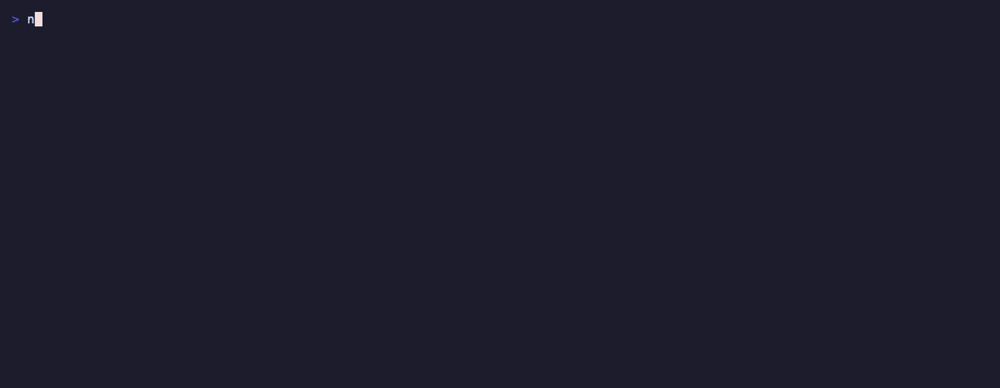

# norcube CLI

[](https://github.com/norcubeplatform/cli/releases/latest)
[](https://github.com/norcubeplatform/cli/actions/workflows/ci.yaml)
[](LICENSE)

Command-line interface for the [Norcube platform](https://norcube.com). Manage backups, namespaces, organizations, and more from the terminal.

What it's best at: proving you're never locked in to Norcube Backup. `norcube backup jobs download` streams any backup straight from storage into `pg_restore` or `mongorestore`, and `norcube backup health` shows whether your backups actually restore — restore-tested against real throwaway databases, not just checksummed.



<sub>Scripted demo with sanitized names: whoami, Backup health, scripting with `-o json --query`, any endpoint with `norcube api`, and your CLI sessions. The tape and stub live in [`demo/`](demo/).</sub>

> **Status**: pre-1.0. Norcube Backup (data sources, backups on demand and downloads, restores, restore tests and their settings, health, policies), LangSync (namespaces, terms, translations, languages, prompts, glossary, API keys, CSV import, audit log, project sync), DomainRadar (domain checks, bulk checks, saved domains, brand monitoring, name generation), Billing (status, subscriptions, usage, invoices, spending caps), organizations, profiles, and `norcube api` for everything else. See the [changelog](CHANGELOG.md).

## Install

**Homebrew (macOS / Linux):**

```bash
brew install --cask norcubeplatform/tap/norcube
```

Installs the binary plus bash/zsh/fish completions. The cask prints how to
add the short `nrc` alias if you want it.

**One-liner (macOS / Linux):**

```bash
curl -fsSL https://github.com/norcubeplatform/cli/raw/main/install.sh | sh
```

Installs to `~/.norcube/bin/norcube` and creates a short alias `nrc` →
`norcube` in the same directory. A per-user location means `norcube upgrade`
never needs sudo. Override the install directory with
`INSTALL_DIR=/usr/local/bin` (system-wide; later upgrades will need sudo),
or pin a version with `VERSION=v0.2.0`.

If `~/.norcube/bin` isn't on your `PATH` yet, the script prints the export
line to add to your shell rc:

```bash
export PATH="$HOME/.norcube/bin:$PATH"
```

The script verifies the SHA-256 against the release's `checksums.txt`
before writing to disk; it'll abort if the download was tampered with.

**Manual install:**

Download the matching archive from the [GitHub Releases page](https://github.com/norcubeplatform/cli/releases/latest), extract `norcube`, and put it on your `$PATH`.

**Windows:**

Download the `.zip` from GitHub Releases. No installer yet.

**From source (requires Go ≥ 1.24):**

```bash
git clone git@github.com:norcubeplatform/cli.git norcube-cli
cd norcube-cli
make install   # installs `norcube` to $GOPATH/bin
```

## Upgrade

```bash
norcube upgrade
```

Checks GitHub for newer releases, verifies the checksum, and atomically
replaces the running binary. Run `norcube --version` afterward to confirm.

If `norcube` was installed via Homebrew / apt / rpm, the upgrade command
detects that and tells you to use the package manager instead — pass
`--force` if you really want to override it.

## Quick start

```bash
norcube login                       # opens your browser, signs you in
norcube whoami                      # who you are and which organization commands target
norcube org use my-org              # target another organization
norcube backup jobs list            # every backup job in the organization
norcube backup health               # which backups actually restore
norcube langsync namespaces list    # LangSync namespaces
norcube domainradar check acme.dev  # is a domain free?
norcube billing usage estimate      # this month's charges so far
norcube doctor                      # something not working? start here
```

`nrc` is a short alias for `norcube` (the install script creates it;
Homebrew prints how). Add `-o json` and `--query` to any command for
scripting, and `--org <slug>` to target another organization for one
command.

## In CI and on servers

Create a CI token for the organization (scopes limit what it can do, and it
always expires), store it as the secret `NORCUBE_TOKEN`, and run commands
as usual:

```bash
norcube auth ci-token create --name "GitHub Actions" --scopes langsync.sync -o text | gh secret set NORCUBE_TOKEN
```

```yaml
- uses: norcubeplatform/setup-norcube@v1
  with:
    token: ${{ secrets.NORCUBE_TOKEN }}
- run: nrc langsync sync
```

On a machine without a browser, `norcube login --device` signs you in with a
code you approve on your phone or laptop. See
[CI and automation](https://docs.norcube.com/platform/cli#ci-and-automation).

## Documentation

- [CLI guide](https://docs.norcube.com/platform/cli): login, profiles,
  organizations, output and scripting, network settings, exit codes,
  troubleshooting.
- [Command reference](https://docs.norcube.com/platform/cli-reference):
  every command and flag, generated from this repository.
- [Backup CLI](https://docs.norcube.com/backup/cli),
  [LangSync CLI](https://docs.norcube.com/langsync/cli), including
  [project sync](https://docs.norcube.com/langsync/cli/project-sync), and
  [DomainRadar CLI](https://docs.norcube.com/domainradar/cli).
- `norcube <command> --help` shows the same reference offline.

## Contributing and security

Contributions are welcome. See [CONTRIBUTING.md](CONTRIBUTING.md) for the
dev setup and the DCO sign-off we require instead of a CLA, and
[docs/ARCHITECTURE.md](docs/ARCHITECTURE.md) for how the code is organized
and how to add a service or a command.
Security issues go through [private vulnerability
reporting](https://github.com/norcubeplatform/cli/security), not public
issues — details in [SECURITY.md](SECURITY.md).

## Open core

This CLI is open source (Apache 2.0) and always will be: the tool that
proves you can take your data and leave should not itself be a lock-in.
The Norcube platform it talks to — the hosted backup scheduling, restore
testing, alerting, and the rest — is a commercial service. The API
surface between them is documented at
[docs.norcube.com](https://docs.norcube.com), so the CLI is also a
reference client if you'd rather script against the API directly.

## License

Apache License 2.0 — see [LICENSE](LICENSE). Use it, fork it, ship it,
including commercially.

"Norcube" and the Norcube logo are trademarks of Norcube; the license does
not grant trademark rights. A fork is welcome to exist, just not to call
itself Norcube.
